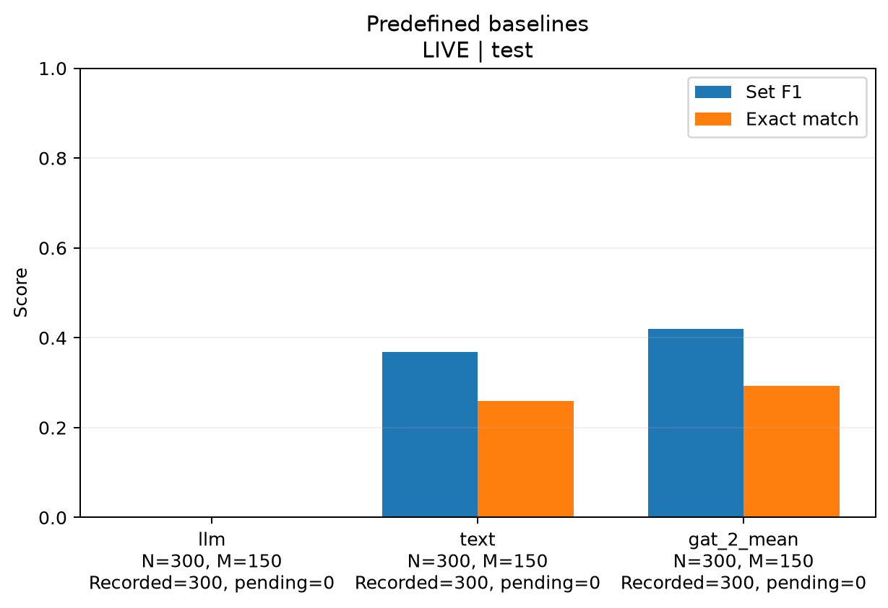
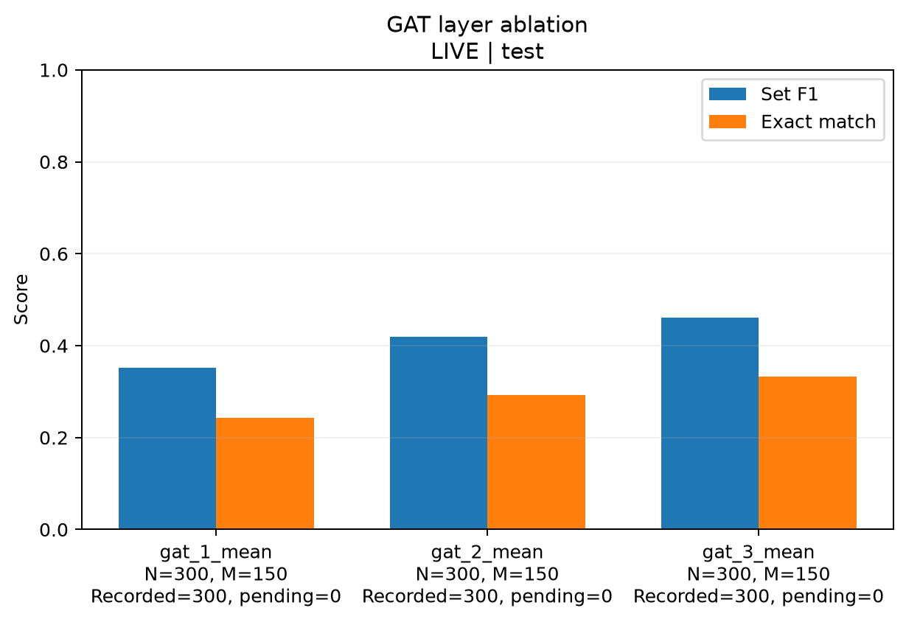
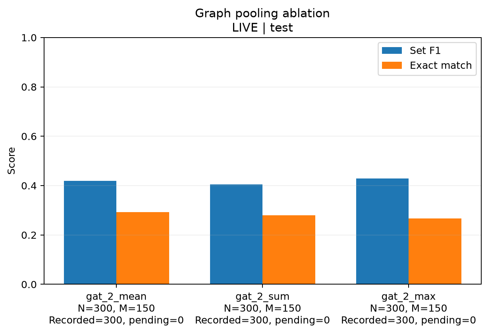
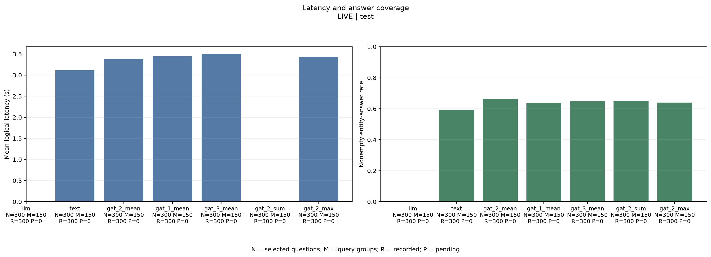

# E 实验评测报告

本报告仅汇总已保存的真实调用记录，结论范围以实际题数和完成状态为准。

划分：test；问题 300 条；查询组 150 组。
实验指纹：8338f68b62f99c7b9e83102d0c98dbc514a941993202d6bd6164fe30f1e4cf3c。清单状态：complete。
主配置预先固定为 gat_2_mean，不按测试结果重新选择最佳配置。

## 组长汇报要点

正式评测用 DeepSeek Flash，覆盖 300 道测试题、150 个逻辑查询组和 2,100 条结果。六个检索配置对同一题共享路由决策、候选集合及证据路径，GAT 改变展示顺序；纯 LLM 不查图谱。系统拒绝了两条含不可见引用的输出（纯 LLM、两层 sum 各一条），按预定规则计零，未事后补跑。

预先固定的两层 mean 相比图谱文本检索，EM 从 26.00% 升到 29.33%，F1 从 36.86% 升到 41.95%（+5.09 个百分点）。按查询组配对的 95% bootstrap 区间为 [−0.55, +11.12] 个百分点，尚不能排除零差异。在层数消融中，三层 mean 的 F1 为 46.05%，比两层高 4.10 个百分点；这是探索性消融，主方案仍用两层。sum 和 max 对 mean 的 F1 区间均跨零。

| 配置 | 回答率 | 上下文答案召回 | 金标外实体比例 | 用于计算该比例的非空回答数 |
|---|---:|---:|---:|---:|
| 纯 LLM（原版） | 0.00% | 不适用 | 不适用 | 0 |
| 图谱文本检索 | 59.33% | 39.89% | 34.55% | 178 |
| 两层 mean（主配置） | 66.33% | 46.62% | 28.35% | 199 |
| 一层 mean | 63.67% | 37.42% | 36.78% | 191 |
| 三层 mean | 64.67% | 49.97% | 21.13% | 194 |
| 两层 sum | 65.00% | 44.96% | 30.43% | 195 |
| 两层 max | 64.00% | 46.94% | 25.04% | 192 |

金标外实体比例是逐题计算后取平均的错误代理。各组回答的题不完全相同，只宜连同分母和回答率一起看，不能用来断定现实事实幻觉率。原版纯 LLM 的 299 条有效生成都选择返回空答案集合；它沿用了带图谱引用和不确定时留空的提示模板。因此，0 分说明这套输出策略在本题集上频繁弃答，不能推广为 DeepSeek 一般问答能力为零。

同题例子：对《哈利·波特与密室》的作曲家出生地（test-00026），文本排序给模型展示了演员等旁支证据，未覆盖正确实体；两层 GAT 把“电影 → 作曲家 John Williams → 出生地 New York”放入上下文，答对此题。反例 test-00184 中，文本检索答出 Accra，两层 GAT 的上下文没有把相关证据排进来，最终弃答。图排序有收益，也会漏证据。

## 补充实验：纯 LLM 的提示词敏感性

原版基线几乎全部弃答后，我们在同一 300 题上单独试了更适合闭卷问答的提示词。仍用 DeepSeek Flash、相同实体解析和评分，只给题面，不查图谱，不要求引用；明确允许提交自己知道的部分答案。这个改动同时改变了引用和弃答措辞，不能把差异归到某一句话上。

| 纯 LLM 提示词 | EM | F1 | 回答率 | 运行错误 |
|---|---:|---:|---:|---:|
| 原版 | 0.00% | 0.00% | 0.00% | 1 |
| 闭卷提示词（事后补充） | 5.33% | 21.01% | 78.33% | 9 |

补充组的 9 条提供商错误按相同规则保留并计零。补充组的金标外实体比例为 71.66%（235 条非空结果）；这个比例与各检索组的分母和回答题目都不同。两组纯 LLM 的差异说明提示词会改变这个基线的表现。本次补充为事后诊断，不替换预先运行的正式表，GAT 的主要对照仍是两组使用相同检索路由的方案。

复现：在仓库根目录配置本地 API 密钥，运行脚本 scripts/run_llm_prompt_sensitivity.py 加参数 --split test --limit 300 --workers 8。补充实验汇总见 [supplemental_llm_prompt.json](supplemental_llm_prompt.json)。

## 指标与解释

EM 比较完整实体答案集合；F1 为每题集合 F1 的宏平均。运行异常及清单中尚未执行的 pending 题保留在选中题分母中并记零分。
评分分母题数：300；已保存记录：2100；pending记录：0。
pending 的零分是完成度计分规则，不是模型已回答的性能；有pending的运行不能称为完整正式实验。
组级结果先对同一逻辑查询的改写取平均，再对查询组取平均。
图谱标准答案不支持比例 = 预测实体中不属于该题金标集合的比例，只对成功且非空的预测定义。
该比例是固定图谱问答的代理指标，不能当作现实事实幻觉率。纯 LLM 没有引用不会自动被判为幻觉。
空回答、明确的映射失败、以及有文本但没有实体 ID 的未决情况分别统计；不能把它们合成同一个幻觉指标。

## 三组基线

| 模式 | 已记录/评分分母/pending题及组数 | 全划分题数 | 状态 | EM | F1 | 回答率 | 运行错误 |
|---|---:|---:|---|---:|---:|---:|---:|
| llm | 300/300/0, M=150 | 300 | complete_split | 0.00% | 0.00% | 0.00% | 1 |
| text | 300/300/0, M=150 | 300 | complete_split | 26.00% | 36.86% | 59.33% | 0 |
| gat_2_mean | 300/300/0, M=150 | 300 | complete_split | 29.33% | 41.95% | 66.33% | 0 |

只有明确记录完整划分规模且覆盖全部题目时才标为 complete_split。少量 smoke/partial 运行不能当作全量测试。

## 五组 GNN 消融

| 配置 | 已记录/评分分母/pending题及组数 | 全划分题数 | 状态 | EM | F1 | 回答率 | 运行错误 |
|---|---:|---:|---|---:|---:|---:|---:|
| gat_1_mean | 300/300/0, M=150 | 300 | complete_split | 24.33% | 35.15% | 63.67% | 0 |
| gat_2_mean | 300/300/0, M=150 | 300 | complete_split | 29.33% | 41.95% | 66.33% | 0 |
| gat_3_mean | 300/300/0, M=150 | 300 | complete_split | 33.33% | 46.05% | 64.67% | 0 |
| gat_2_sum | 300/300/0, M=150 | 300 | complete_split | 28.00% | 40.42% | 65.00% | 1 |
| gat_2_max | 300/300/0, M=150 | 300 | complete_split | 26.67% | 42.90% | 64.00% | 0 |

缺失配置保持 unknown，不补造数值，不据不完整数据描述提升趋势。

## 配对组级 F1 差与 95% bootstrap 区间

比较使用双方共同 question_id，并按选中清单补入pending零分。组是抽样单位；少于两组或pending组映射不完整时不生成区间。
不重叠题数明确列出，区间只适用于共同覆盖的样本；小样本区间属于探索性描述。

| 对比 候选减参考 | 配对题/组 | 差值 | 95% 区间 | 参考独有题 | 候选独有题 |
|---|---:|---:|---|---:|---:|
| text - llm | 300/150 | 0.3686 | [0.2955, 0.4392] | 0 | 0 |
| gat_2_mean - text | 300/150 | 0.0509 | [-0.0055, 0.1112] | 0 | 0 |
| gat_1_mean - gat_2_mean | 300/150 | -0.0680 | [-0.1105, -0.0272] | 0 | 0 |
| gat_3_mean - gat_2_mean | 300/150 | 0.0410 | [0.0096, 0.0754] | 0 | 0 |
| gat_2_sum - gat_2_mean | 300/150 | -0.0153 | [-0.0532, 0.0221] | 0 | 0 |
| gat_2_max - gat_2_mean | 300/150 | 0.0095 | [-0.0211, 0.0416] | 0 | 0 |

## 实际开销与逻辑开销

逻辑开销描述该题完整推理所需的历史请求；实际开销只统计本次执行新增调用。缓存命中不能重复算作本次调用。
缺失 token 或耗时保持 unknown。known_total 只是已报告部分之和，不能称为完整总量。
按题累计的请求耗时不等同于并发实验的墙钟时间。这里不猜测 API 单价或精确账单。

| 模式 | 逻辑输入/输出 token | 实际输入/输出 token | 逻辑/实际耗时合计 秒 | usage已报告题 |
|---|---|---|---|---:|
| gat_1_mean | 595249.0000 / 56510.0000 | 292178.0000 / 38497.0000 | 1033.4300 / 512.9281 | 300/300 |
| gat_2_max | 596650.0000 / 58274.0000 | 293579.0000 / 40261.0000 | 1029.0717 / 508.5699 | 300/300 |
| gat_2_mean | 597793.0000 / 57849.0000 | 294722.0000 / 39836.0000 | 1017.5282 / 497.0262 | 300/300 |
| gat_2_sum | unknown / unknown | 293385.0000 / 39681.0000 | unknown / 509.9063 | 299/300 |
| gat_3_mean | 598348.0000 / 58086.0000 | 295277.0000 / 40073.0000 | 1049.9693 / 529.4674 | 300/300 |
| llm | unknown / unknown | 68172.0000 / 18986.0000 | unknown / 289.3150 | 299/300 |
| text | 600235.0000 / 63128.0000 | 600235.0000 / 63128.0000 | 934.7330 / 934.7428 | 300/300 |

已记录服务模型：deepseek-flash。
若实际服务模型不一致，需在最终结论中说明，不能宣称严格固定了同一模型。

## 错误分析

共 1659 条未完全正确或待复核记录，原始错误清单与推理日志保存在组长本地实验目录。
未解析名称、歧义名称、被拒绝实体ID分别计数；空ID且有诊断时单列normalization_unresolved（名称解析未完成），不认定自然语言答案正确。mapping_failure_count表示出现解析问题的题数，可能包含部分解析成功的回答。

## 名称解析诊断

| 配置 | 未解析名称题数 | 歧义名称题数 | 拒绝ID题数 | 空ID且解析未完成 | 模型尝试回答题数 |
|---|---:|---:|---:|---:|---:|
| gat_1_mean | 1 | 25 | 1 | 0 | 191 |
| gat_2_max | 0 | 28 | 0 | 0 | 192 |
| gat_2_mean | 2 | 29 | 3 | 1 | 200 |
| gat_2_sum | 0 | 31 | 0 | 0 | 195 |
| gat_3_mean | 2 | 28 | 2 | 2 | 196 |
| llm | 0 | 0 | 0 | 0 | 0 |
| text | 29 | 27 | 30 | 28 | 206 |

这些是诊断题数，可在同一道题上重叠；详细名称、候选ID、题面及trace_file保存在错误清单。

## 图表

